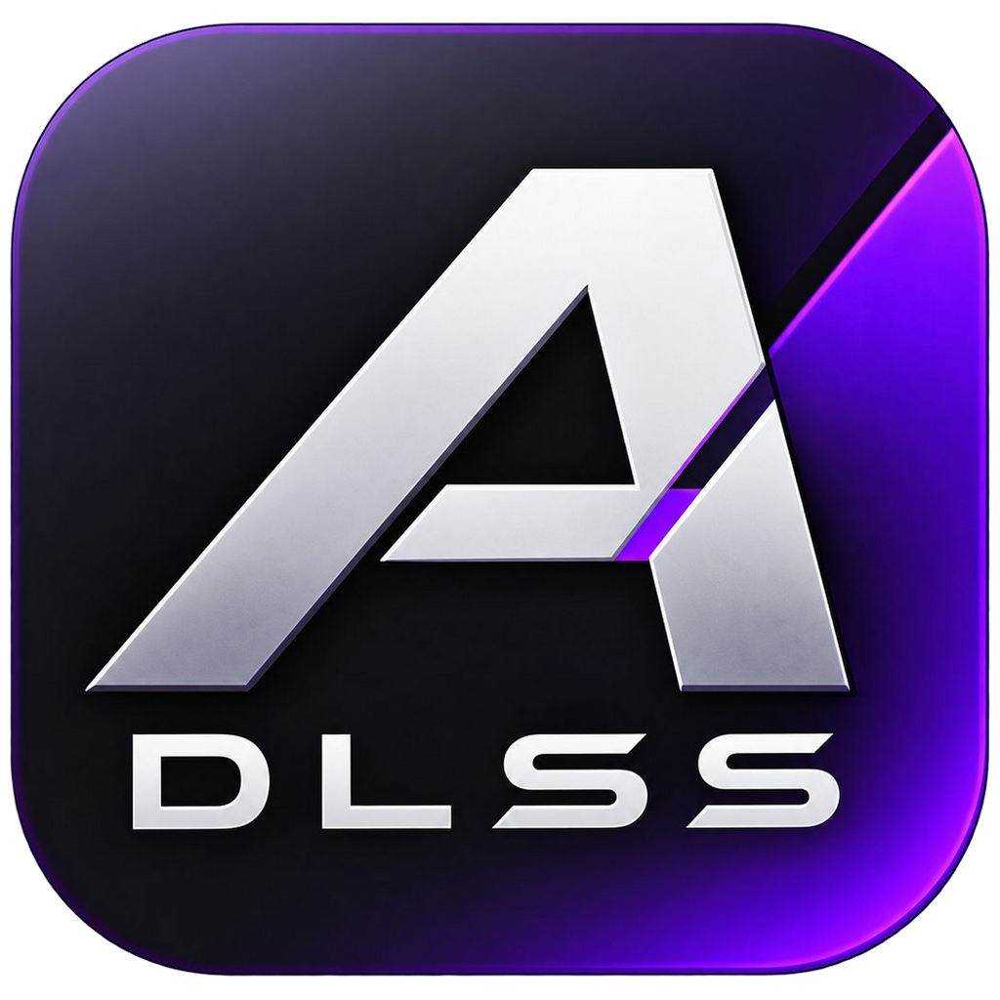
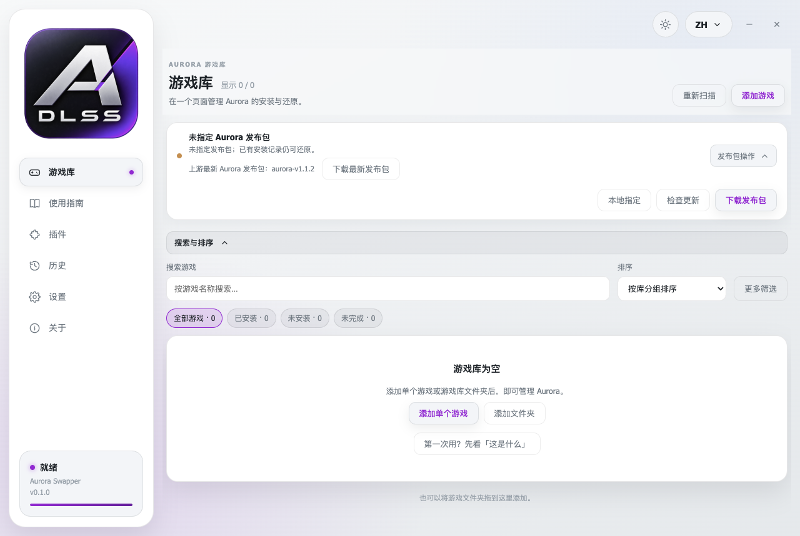
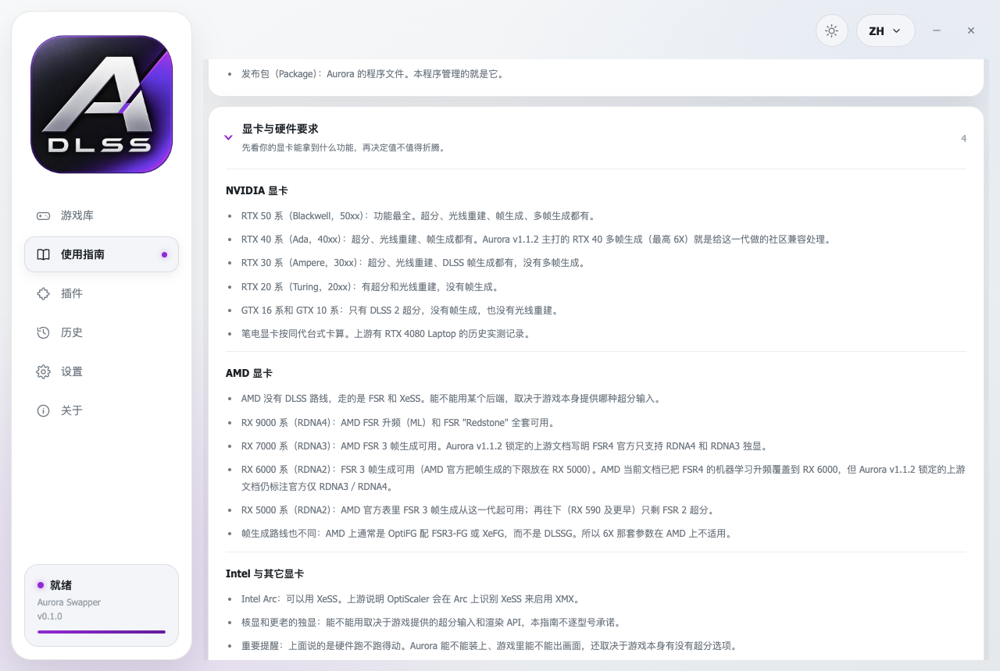
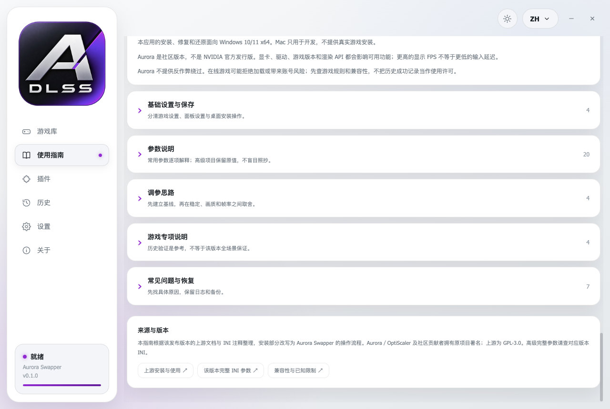

<p align="center">
  
</p>

<h1 align="center">Aurora Swapper</h1>

<p align="center">Install, repair, and restore <a href="https://github.com/abc354402600/OptiScaler-Aurora">OptiScaler Aurora</a> for your games.</p>

<p align="center">
  <a href="#download">Download</a> ·
  <a href="#what-it-does">What it does</a> ·
  <a href="#gpu-support">GPU support</a> ·
  <a href="#the-guide">The guide</a> ·
  <a href="#build-from-source">Build from source</a> ·
  <a href="#license-and-credits">License and credits</a>
</p>

<p align="center"><a href="README.md">简体中文</a> · <b>English</b></p>

---

## What it is

Aurora Swapper is a small Windows desktop tool with one job: install OptiScaler Aurora into your games correctly, repair it when something breaks, and take it back out again at any time.

Every graphics feature comes from Aurora itself. This application adds **no graphics features of its own** — it only installs, repairs, and restores:

| Action | What actually happens |
| --- | --- |
| **Install** | Places the Aurora runtimes and one proxy DLL into the game folder you chose, then calls `runtime_sync.ps1` to sync the runtimes. |
| **Repair** | Restores the correct file state after a game update, a launcher verification, or your own manual edits. |
| **Restore** | Removes the files Aurora added and puts the original DLL backups back byte for byte. |

Apart from those three, it leaves your game alone: no edits to game files, no uploads, no other mods, no gameplay changes. Replaced originals are backed up automatically and returned exactly as they were.

**What it is not**

- Not a game trainer: no health, damage, speed, or other gameplay values are touched, and it contains nothing that cheats.
- It does not bypass anti-cheat: online games may refuse to load third-party runtimes, and there is an account risk. Check the game rules and the compatibility list first.
- Not a "graphics overhaul pack": what you actually get depends on your GPU, driver, game, and settings. Compare in game.
- It cannot be installed everywhere: older DirectX 9 titles, and games that already load another mod loader, usually fail or conflict.
- A higher frame rate is not a lower latency: generated frames add input delay and ghosting.

---

## Download

Windows portable and installer builds are on the [Releases page](https://github.com/SpikeJulia/Aurora-Swapper/releases/latest).

The portable build is a single `.exe` that runs where it sits; the installer creates desktop and Start-menu shortcuts. Neither bundles the Aurora package — download it in Settings on first run, or point the app at an already extracted folder.

### Windows will say the publisher is unknown

This app is **not signed with a Windows code-signing certificate**, so Windows shows a blue "Windows protected your PC" dialog or reports the publisher as unknown when you install it. That is a **signing notice, not malware**, and not a broken download — the only reason is that no paid certificate was bought.

To continue:

1. Choose "More info", then "Run anyway".
2. After installing the installer build, right-click the **Aurora Swapper** shortcut in the Start menu or on the desktop, choose Properties, tick "Unblock", and apply it. Windows stops asking afterwards.

To confirm the file you have is the published one, check it against [`SHA256SUMS.txt`](https://github.com/SpikeJulia/Aurora-Swapper/releases/latest/download/SHA256SUMS.txt) on the release page:

```powershell
Get-FileHash .\Aurora-Swapper-<version>-portable.exe -Algorithm SHA256
```

A digest that matches the one in `SHA256SUMS.txt` means the bytes are exactly the published ones.

If your organisation does not allow unsigned software to run, go through your IT approval process rather than working around it.

---

## What it does

### Game library

<p align="center">
  
</p>

- Reads Steam's `libraryfolders.vdf`, and accepts any game folder or whole library folder added by hand.
- Search by name; filter by Aurora status (not installed, installed, incomplete, needs review) and other conditions.
- Sort by recently played, by library, or by name in either direction.
- Game details let you pick a proxy DLL (`dxgi.dll`, `winmm.dll`, `version.dll`, and others), install, repair runtimes, restore originals, or open the game folder.
- Known games come with a preselected proxy and a note — the Witcher 3 uses `dxgi.dll`, Neverness to Everness uses `winmm.dll`.

### Two sources for the package

- **Specify locally**: point at an already extracted Aurora folder. Fully offline.
- **Download**: fetch the complete package from the upstream release, verify its SHA-256, and unpack it. A failed download keeps your existing valid package instead of overwriting it. The Chinese interface defaults to a mainland mirror and other languages default to the official source; both can be switched by hand in the download window.

### Repair and restore

- After a game update or a launcher verification, "Repair runtimes" puts the files back into their correct state.
- A preserved runtime is sometimes downgrade or legacy protection rather than a failure — read the actual output in the app's History page.
- A failed restore never deletes files. Backups and manifests are kept for the next attempt.

### Upstream update check

The app checks for a newer upstream package on startup, caches the answer for 24 hours, and can be forced to re-check at any time. A SHA-256 digest tells a same-tag republish apart from a real new release. A local package without version information shows as "unknown" rather than claiming to be current.

---

## The guide

A read-only offline guide ships with the app. It never edits your configuration and never runs anything.

<p align="center">
  
</p>

Eight sections, fifty-two entries, Chinese and English:

| Section | What it covers |
| --- | --- |
| What this is | For people who have never used a tool like this: what it does, what it cannot do, what to prepare, and a glossary |
| GPU and hardware requirements | What each graphics card generation gets you, plus the four gates that trip people up more than the model does |
| Quick start | From preparing the package to opening the in-game Aurora panel, step by step, with what success looks like |
| Basic settings and saving | Finding the right game folder, separating game settings from overlay settings, saving and rolling back |
| Parameter reference | Each common control explained: what it does, its values, when it applies, restart behaviour, and how to revert |
| Tuning strategies | Stability, quality, or frame rate — and a repeatable test loop that changes one setting at a time |
| Game-specific notes | Games with historical validation, their proxy recommendations, and the known boundaries |
| Troubleshooting and recovery | Overlay not opening, only 2X available, crashes and corruption, breakage after an update, failed restores |

<p align="center">
  
</p>

The guide is pinned to Aurora `aurora-v1.1.2` (commit `1d22875d05fac2d7ffb86ed912b943ce1a6e915a`); the review date is printed at the top of the guide page. Downloading a newer Aurora package never silently rewrites this offline guide.

---

## GPU support

What the hardware can run and whether Aurora installs and shows up in game are two different questions. The table below is the first one. The second still depends on the game offering an upscaling option at all.

| Graphics card | What you get |
| --- | --- |
| **NVIDIA RTX 50 series** | Upscaling, ray reconstruction, frame generation, multi-frame generation — everything |
| **NVIDIA RTX 40 series** | Upscaling, ray reconstruction, frame generation, multi-frame generation. The RTX 40 multi-frame generation up to 6X that Aurora leads with is community compatibility work for this generation |
| **NVIDIA RTX 30 series** | Upscaling, ray reconstruction, DLSS frame generation; no multi-frame generation |
| **NVIDIA RTX 20 series** | Upscaling and ray reconstruction; no frame generation |
| **NVIDIA GTX 16 / 10 series** | DLSS 2 upscaling only |
| **AMD RX 9000 series** | The full AMD FSR upscaling (ML) and FSR "Redstone" feature set |
| **AMD RX 7000 series** | AMD FSR 3 frame generation |
| **AMD RX 6000 series** | FSR 3 frame generation (AMD puts the frame-generation floor at RX 5000) |
| **AMD RX 5000 series** | FSR 3 frame generation; RX 590 and older keep FSR 2 upscaling only |
| **Intel Arc** | XeSS |

Laptop GPUs count as their desktop counterparts. AMD has no DLSS route: it goes through FSR and XeSS, where frame generation usually means OptiFG with FSR3-FG or XeFG, so the 6X parameters do not apply.

Four things cause more wasted effort than the graphics card model: the game must provide an upscaling input; the rendering API must be supported (OptiFG frame generation is DX12 only); the driver build has to match; and one game can only have one proxy.

---

## Requirements

- Windows 10/11 x64 (installation, repair, and restore all run on Windows)
- A graphics card that can run the upscaler backend you want, with its drivers installed
- The interface speaks 13 languages: English, 简体中文, العربية, Español, Português, Русский, Deutsch, Français, 日本語, 한국어, Italiano, Türkçe, Polski

---

## Build from source

```bash
git clone https://github.com/SpikeJulia/Aurora-Swapper.git
cd Aurora-Swapper
npm install
npm start
```

Build the Windows portable executable:

```bash
npm run icon          # turns assets/logo.png into build/icon.ico; the .ico is not in the repository
npm run build:portable
```

`npm run build` runs `npm run payload` first. That collects the ReShade / DLSS5-Feeder add-on payload inherited from DLSS 5 Swapper. When it cannot find a local DLSS 5 folder it prints one line and exits with status 0, which **does not break the build** — the Aurora install path never uses that directory. The Aurora package is downloaded by the app at runtime, or pointed at by the user.

Run the tests:

```bash
npm test              # Aurora-specific tests
npm run test:legacy  # the inherited Swapper test suite
```

Development happens mainly on macOS. PowerShell is only invoked when `process.platform === 'win32'`; the macOS tests use temporary directories and never execute PowerShell.

---

## License and credits

- This repository's code is released under the **MIT** license. The interface is derived from [DLSS 5 Swapper](https://github.com/rakanki911/DLSS5-Swapper) 2.2.7 (Rakan Alkhaldi, MIT), and the original copyright notice is preserved in [LICENSE](LICENSE).
- [OptiScaler Aurora](https://github.com/abc354402600/OptiScaler-Aurora) itself is **GPL-3.0**. Its package is **not** distributed with this application; you select or download it yourself.
- Third-party components and their licences are listed in [THIRD_PARTY_NOTICES.md](THIRD_PARTY_NOTICES.md).
- Chinese localisation completed by 显卡长安.
- Developer: [spikejulia](https://github.com/spikejulia)

---

## Disclaimer

This project is not affiliated with NVIDIA, AMD, or Intel and does not represent official support from any of them. Aurora is a community project, not an official NVIDIA release. Check each game's own rules and licensing before you use it.
