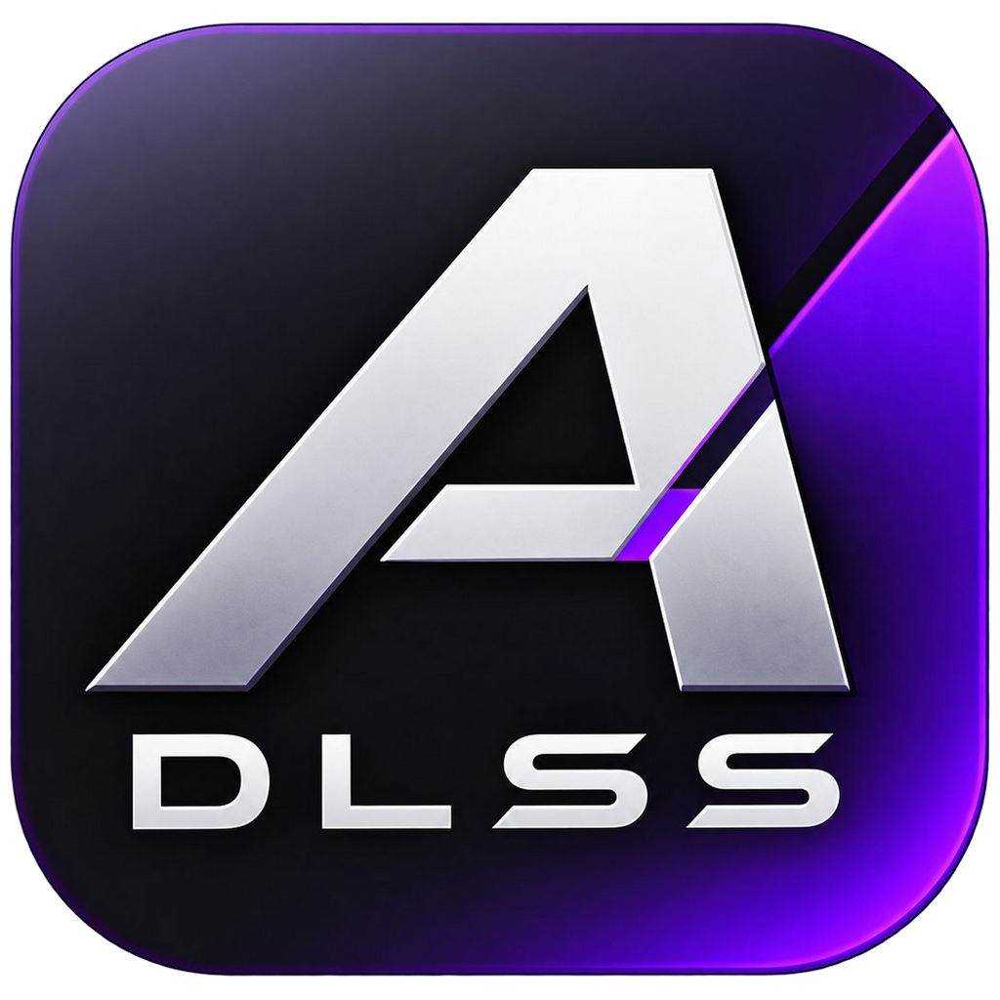
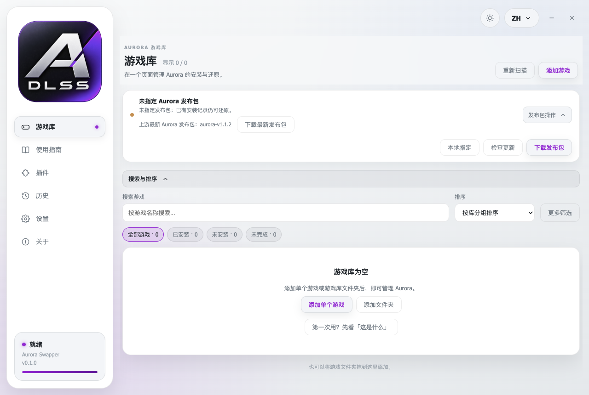
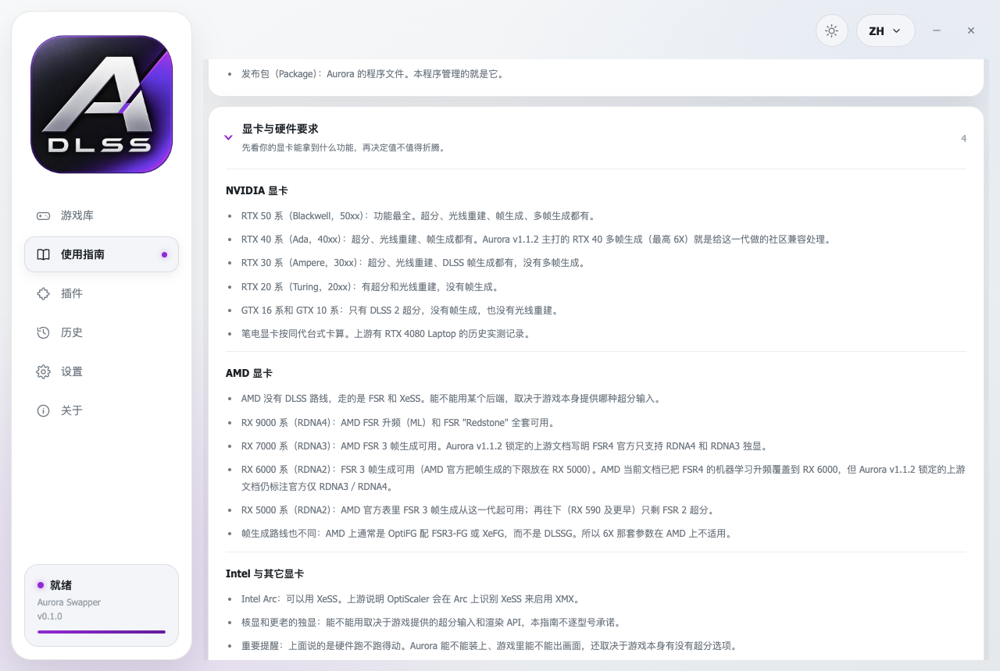
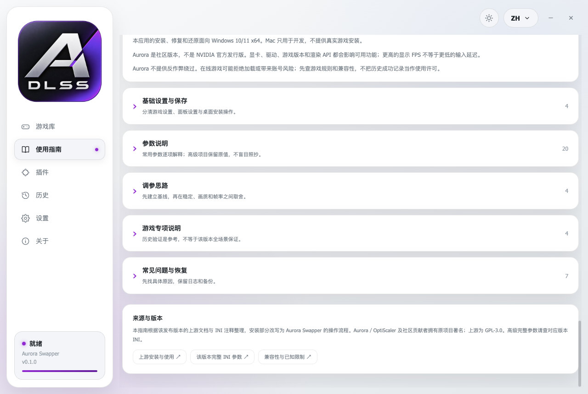

<p align="center">
  
</p>

<h1 align="center">Aurora Swapper</h1>

<p align="center">为你的游戏安装、修复和还原 <a href="https://github.com/abc354402600/OptiScaler-Aurora">OptiScaler Aurora</a>。</p>

<p align="center">
  <a href="#下载">下载</a> ·
  <a href="#它做什么">它做什么</a> ·
  <a href="#显卡支持">显卡支持</a> ·
  <a href="#使用指南">使用指南</a> ·
  <a href="#从源码构建">从源码构建</a> ·
  <a href="#许可证与致谢">许可证与致谢</a>
</p>

<p align="center"><b>简体中文</b> · <a href="README.en.md">English</a></p>

---

## 它是什么

Aurora Swapper 是一个 Windows 桌面小工具，只做一件事：把 OptiScaler Aurora 正确地装进你的游戏，装坏了能修回来，随时能还原成原样。

画质功能全部来自 Aurora 本身。这个程序**自己不提供任何画质功能**，只负责安装、修复、还原三件事：

| 动作 | 具体做什么 |
| --- | --- |
| **安装** | 把 Aurora 的运行库和一个「代理 DLL」放进你指定的游戏目录，并调用 `runtime_sync.ps1` 同步运行库。 |
| **修复** | 游戏更新、启动器校验文件、或者你自己动过目录之后，把文件补回正确状态。 |
| **还原** | 撤掉 Aurora 装进去的文件，把游戏原本的 DLL 备份原样放回。 |

除这三件事之外，程序不碰你的游戏：不改游戏本体文件、不上传任何数据、不装其他 Mod、不改游戏数值。被替换掉的游戏原文件会被自动备份，还原时按字节放回。

**它不是什么**

- 不是修改器：不改血量、伤害、速度这类数值，也不含任何作弊功能。
- 不绕过反作弊：联网游戏可能拒绝加载第三方运行库，甚至带来账号风险。先查游戏规则和兼容性白名单。
- 不是「画质增强包」：装上之后到底什么效果，取决于你的显卡、驱动、游戏和设置，需要自己进游戏对比。
- 不保证所有游戏都支持：老的 DirectX 9 游戏，以及已经装了别的 Mod Loader 的游戏，通常装不上或会互相冲突。
- 帧率变高不等于延迟变低：帧生成补出来的帧会增加操作延迟和鬼影。

---

## 下载

Windows 便携版和安装版都在 [Releases 页面](https://github.com/SpikeJulia/Aurora-Swapper/releases/latest)。

便携版是单个 `.exe`，解压即用；安装版会创建桌面和开始菜单快捷方式。两者都不捆绑 Aurora 发布包——第一次使用需要在「设置」页下载，或者指定本机已解压好的发布目录。

---

## 它做什么

### 游戏库

<p align="center">
  
</p>

- 读取 Steam 的 `libraryfolders.vdf`，也可以手动添加任意游戏目录或整个游戏库文件夹。
- 按名称搜索，按 Aurora 状态（未安装／已安装／安装未完成／状态待确认）和其它条件筛选。
- 排序按最近游玩、按库分组、名称 A–Z、名称 Z–A。
- 详情页里选代理 DLL（`dxgi.dll`、`winmm.dll`、`version.dll` 等）、安装、修复运行库、还原原始文件、打开游戏目录。
- 已知游戏会带预选代理和说明，例如巫师 3 用 `dxgi.dll`、异环用 `winmm.dll`。

### 发布包两种来源

- **本地指定**：指向本机已经解压好的 Aurora 目录，完全离线。
- **在线下载**：从上游 Release 下载完整发布包，校验 SHA-256 后解压。下载失败时保留你现有的有效发布包，绝不覆盖。中文界面默认走国内镜像，其它语言默认走官方源，可在下载窗口里手动切换。

### 修复与还原

- 游戏更新或启动器校验之后，用「修复运行库」把文件补回正确状态。
- 运行库被保留有时是防降级或旧版保护，不一定是失败——以本程序「历史」页里的具体输出为准。
- 还原失败时程序不会删文件；备份和清单会保留下来供下一次尝试。

### 上游更新检查

启动时检查一次上游最新发布包，24 小时缓存一次，也可以随时强制重查。用 SHA-256 区分「同一个 tag 重新发布」的情况。本地包没有版本信息时状态显示为「未知」，而不是谎报「已是最新」。

---

## 使用指南

应用内置一份离线指南，只读，不修改你的任何配置，也不执行脚本。

<p align="center">
  
</p>

八个章节、五十一条说明，中英双语：

| 章节 | 内容 |
| --- | --- |
| 这是什么 | 面向没用过这类工具的人：它能做什么、不能做什么、要准备什么、名词速查 |
| 显卡与硬件要求 | 按显卡系列说明能拿到哪些功能，以及比显卡型号更容易卡住人的四条门槛 |
| 快速上手 | 从准备发布包到第一次打开游戏内的 Aurora 面板，每步写明点哪里、成功长什么样 |
| 基础设置与保存 | 怎么找对游戏目录、面板设置与桌面操作的分工、保存与回退 |
| 参数说明 | 常用参数逐项解释：作用、取值、适用条件、生效与重启、恢复方法 |
| 调参思路 | 稳定／画质／帧率三种取向，以及一次只改一项的实测流程 |
| 游戏专项说明 | 有历史验证记录的游戏，含各游戏的代理建议与已知边界 |
| 常见问题与恢复 | 面板打不开、只能 2X、闪退花屏、更新后失效、还原失败等 |

<p align="center">
  
</p>

指南内容钉死在 Aurora `aurora-v1.1.2`（提交 `1d22875d05fac2d7ffb86ed912b943ce1a6e915a`），核对日期写在指南页顶部。下载新的 Aurora 包不会静默改写这份离线指南。

---

## 显卡支持

硬件能跑什么，和 Aurora 能装上、能不能出画面，是两件事。下面是前者；后者还取决于游戏本身有没有超分选项。

| 显卡 | 能拿到什么 |
| --- | --- |
| **NVIDIA RTX 50 系** | 超分、光线重建、帧生成、多帧生成，功能最全 |
| **NVIDIA RTX 40 系** | 超分、光线重建、帧生成、多帧生成。Aurora 主打的 RTX 40 多帧生成（最高 6X）就是给这一代做的社区兼容处理 |
| **NVIDIA RTX 30 系** | 超分、光线重建、DLSS 帧生成，没有多帧生成 |
| **NVIDIA RTX 20 系** | 超分、光线重建，没有帧生成 |
| **NVIDIA GTX 16 / 10 系** | 只有 DLSS 2 超分 |
| **AMD RX 9000 系** | AMD FSR 升频（ML）与 FSR "Redstone" 全套 |
| **AMD RX 7000 系** | FSR 3 帧生成可用 |
| **AMD RX 6000 系** | FSR 3 帧生成可用（AMD 官方把帧生成下限放在 RX 5000） |
| **AMD RX 5000 系** | FSR 3 帧生成可用；RX 590 及更早只剩 FSR 2 超分 |
| **Intel Arc** | XeSS 可用 |

笔电显卡按同代台式卡算。AMD 没有 DLSS 路线，走的是 FSR 和 XeSS，帧生成路线通常是 OptiFG 配 FSR3-FG 或 XeFG，6X 那套参数不适用。

比显卡型号更容易让人白折腾一遍的，是这四条：游戏本身要有超分输入；渲染 API 要在支持范围内（OptiFG 帧生成只支持 DX12）；驱动版本要对；同一个游戏只能有一个代理。

---

## 系统要求

- Windows 10/11 x64（安装、修复、还原都在 Windows 上完成）
- 需要一块能跑所选超分后端的显卡和装好的驱动
- 界面支持 13 种语言：English、简体中文、العربية、Español、Português、Русский、Deutsch、Français、日本語、한국어、Italiano、Türkçe、Polski

---

## 从源码构建

```bash
git clone https://github.com/SpikeJulia/Aurora-Swapper.git
cd Aurora-Swapper
npm install
npm start
```

打包 Windows 便携版：

```bash
npm run icon          # 由 assets/logo.png 生成 build/icon.ico，仓库里不含该文件
npm run build:portable
```

`npm run build` 会先跑 `npm run payload`，它收集的是从 DLSS 5 Swapper 继承来的 ReShade／DLSS5-Feeder 插件包。找不到本机的 DLSS 5 文件时它只打印一行提示并以 0 退出，**不影响打包**——Aurora 的安装流程不使用这个目录，Aurora 发布包由应用自己在运行时下载或由用户指定。

跑测试：

```bash
npm test          # Aurora 专项测试
npm run test:legacy   # 继承自 Swapper 的旧测试套件
```

开发主要在 macOS 上进行；只有 `process.platform === 'win32'` 时才会调用 PowerShell，Mac 上的测试使用临时目录，不会执行 PowerShell。

---

## 许可证与致谢

- 本仓库的代码以 **MIT** 许可发布。界面派生自 [DLSS 5 Swapper](https://github.com/rakanki911/DLSS5-Swapper) 2.2.7（Rakan Alkhaldi，MIT），原始版权声明保留在 [LICENSE](LICENSE)。
- [OptiScaler Aurora](https://github.com/abc354402600/OptiScaler-Aurora) 本身是 **GPL-3.0**。它的发布包**不**随本应用分发，需要你自行指定或在线下载。
- 第三方组件与各自许可见 [THIRD_PARTY_NOTICES.md](THIRD_PARTY_NOTICES.md)。
- 中文本地化由显卡长安补全。
- 开发者：[spikejulia](https://github.com/spikejulia)

---

## 免责声明

本项目与 NVIDIA、AMD、Intel 无关，也不代表这些厂商的官方支持。Aurora 是社区项目，不是 NVIDIA 官方发行版。请自行确认游戏的许可与规则后再使用。
